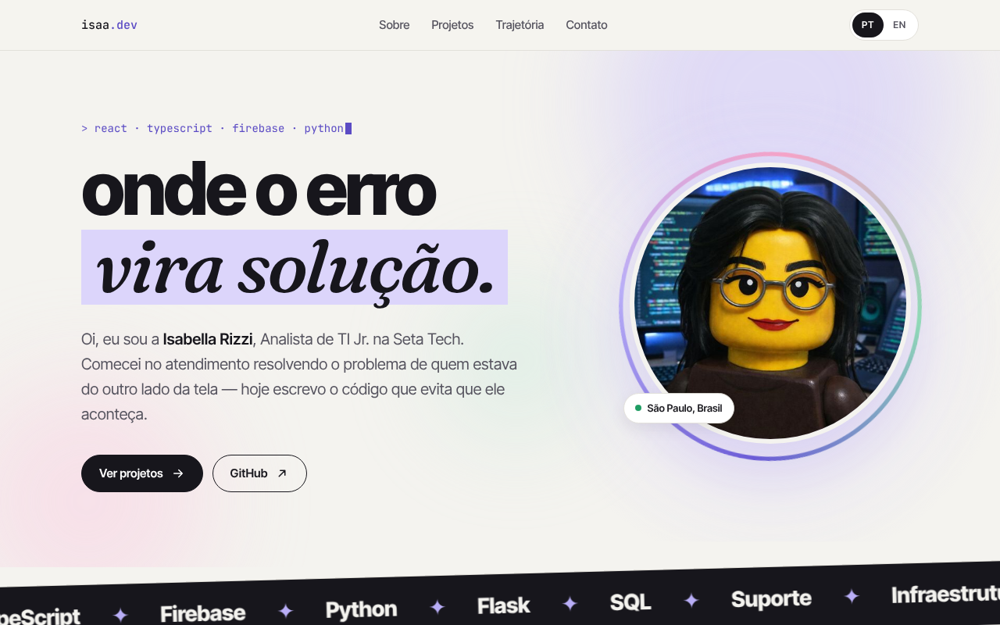

<div align="center">

# isaa.dev — Portfólio

**Isabella Rizzi · Analista de TI Jr. @ Seta Tech**
`> where bugs become solutions_`

[](https://isaa-dev.github.io/Portfolio/)
[](https://www.linkedin.com/in/isabella-correia-rizzi-20b419217)



</div>

---

## ✨ Sobre o site

Portfólio pessoal em **uma única página**, com versão em **português e inglês** (botão PT/EN no topo) e a mesma identidade visual do meu LinkedIn.

**Seções:** apresentação · sobre · projetos · trajetória · contato

## 🎬 Animações

- Título que aparece palavra por palavra, com marcador lilás animado
- Linha de terminal que se digita sozinha
- Anel em gradiente girando em volta da foto e formas flutuando no fundo
- Faixa da stack rolando em loop
- Seções que surgem conforme a rolagem e barra de progresso no topo
- Cards de projeto com inclinação 3D e luz que segue o cursor
- Botões "magnéticos" e brilho que acompanha o mouse

Tudo respeita a configuração de **movimento reduzido** do sistema: quem prefere menos animação vê o site estático.

## 🛠️ Feito com

HTML, CSS e JavaScript puros: **sem frameworks e sem build**. Um único `index.html`, com fontes do Google Fonts (Inter Tight, Fraunces e JetBrains Mono).

## 🚀 Rodar localmente

```bash
git clone https://github.com/Isaa-dev/Portfolio.git
cd Portfolio
# abra o index.html no navegador
```

Publicado com **GitHub Pages** a partir da branch `main`.
